# Video Segmentation & Tracking

Segment objects in a video by annotating a few keyframes, then track every object through the whole video with the SAM3 Video Service running on a GPU node. Results export as an annotated MP4, COCO JSON, or a full frames-and-masks dataset written straight to HPC storage via Tapis.

### License

[](https://opensource.org/licenses/BSD-3-Clause)

**Tags:** AI4CI, CI4AI, Software

## References

- [Tapis v3 — HPC job execution framework](https://tapis-project.org)
- [SAM3 (Segment Anything Model 3) — Meta AI](https://github.com/facebookresearch/sam3)
- [COCO JSON format specification](https://cocodataset.org/#format-data)
- [Smart Labeler — Image Segmentation](./SEGMENTATION_README.md)
- [Video Segmentation changelog](./VIDEO_SEGMENTATION_CHANGELOG.md)

## Acknowledgements

*National Science Foundation (NSF) funded AI institute for Intelligent Cyberinfrastructure with Computational Learning in the Environment (ICICLE) (OAC 2112606)*

## Issue reporting

Please open an issue at [github.com/OSU-SAI-Lab/smart-labeler/issues](https://github.com/OSU-SAI-Lab/smart-labeler/issues) with a description of the problem, steps to reproduce, the service address shown in the status bar, and the tracking job id if a job failed.

---

# Tutorials

### Tracking Your First Video

A complete walkthrough from a raw video to tracked masks in 5 steps.

#### Prerequisites

- A Tapis account with a valid Slurm account to charge
- A running SAM3 Video Service, reachable either through the deployment's auth gateway or an SSH tunnel to a GPU node (see [How to Connect to the SAM3 Video Service](#how-to-connect-to-the-sam3-video-service))
- A video file (MP4 recommended) on your computer or on a Tapis-connected HPC system
- (Optional) A Hugging Face token with SAM3 access, if your deployment downloads the model on your behalf — see [How to Set Up Hugging Face Access](./SEGMENTATION_README.md#how-to-set-up-hugging-face-access)

#### Getting Started

Navigate to the home page and click **Get Started** or **Dashboard**.

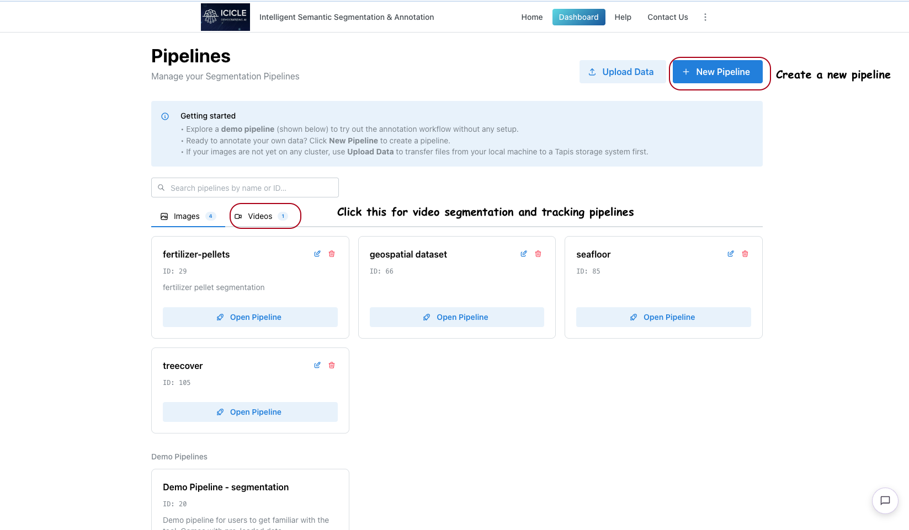

On a segmentation deployment, the dashboard lists pipelines under two tabs: **Images** and **Videos**. Open the **Videos** tab to see existing video pipelines, each with its ID and an **Open Pipeline** button.


Click **+ New Pipeline** to open the creation modal. Provide a **Pipeline Name** and a **SLURM Account** (required). Under **What will you annotate?**, choose **Video — segment and track through a video**. This choice fixes which workspace the pipeline opens in and cannot be changed later. Add an optional **Description** and click **Create & Open**.

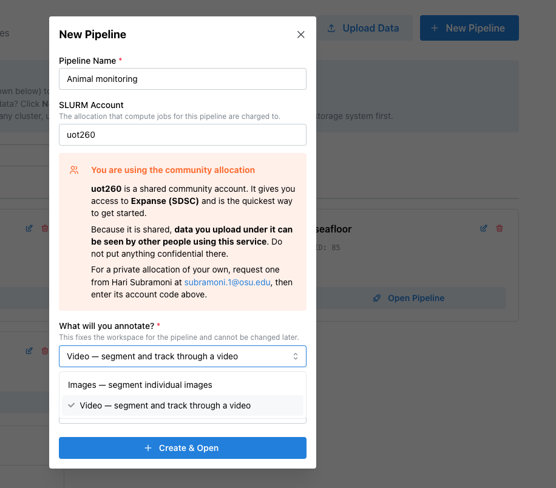

The video workspace opens with a five-step guide across the top: **Upload video → Add objects → Annotate keyframes → Track → Review & export**. The hint under the stepper changes with the active step. Click the **?** icon for a short primer on how tracking works.

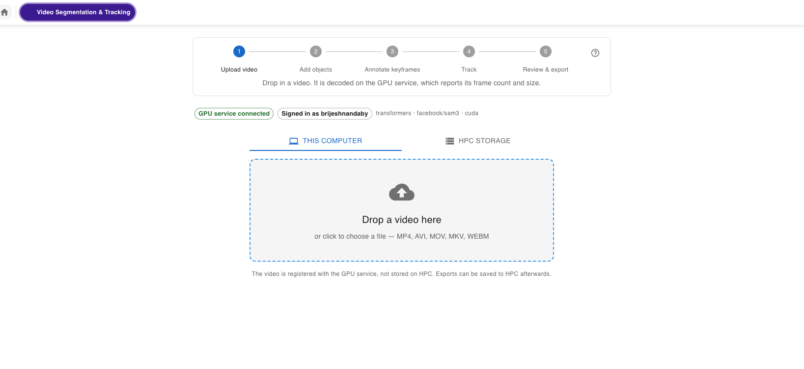

#### Checking the Service Connection

Before anything else, the workspace contacts the SAM3 Video Service and shows the result under the stepper:

- **GPU service connected** — ready to go. The model backend, model ID, and device are shown alongside.
- **Signed in as \<user\>** — shown when the deployment uses the auth gateway.
- **Mock mode — placeholder masks, not real tracking** — the service is running without the model. Masks are not real.
- **Loading model weights — first track may be slow** — the service has just started. The first tracking job will wait for the model.
- **Video GPU service unavailable** — the service could not be reached. The message names the address tried. Fix the connection and click **Retry**.

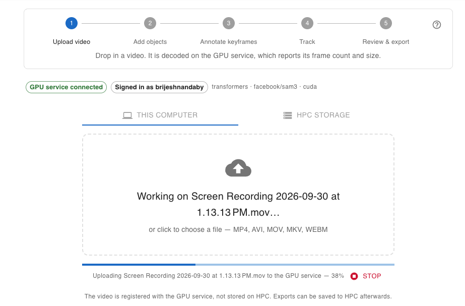


#### Step 1 — Upload Video

Choose where the video comes from:

- **This computer** — drag a video onto the drop zone, or click it to browse. A progress bar shows the upload.
- **HPC storage** — pick a **System**, then enter the **Video file path** or click the browse icon to find it. The video is downloaded from Tapis and sent on to the GPU service, with progress shown for both stages.

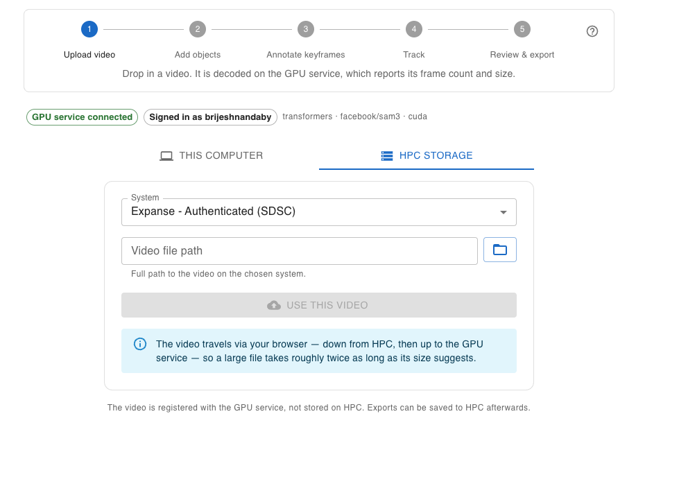

The service decodes the video and reports its frame count, resolution, and frame rate. Long videos are split into **chunks** of about a thousand frames.

If the upload fails, the message explains the cause. The most common one, **That video file looks incomplete**, means the MP4 is missing its index — usually because it was still being copied or recorded. Re-copy the file and try again.

#### Step 2 — Add Objects

Each thing you want tracked is an **object** with a label and a colour. Objects keep the same ID on every keyframe, which is how the tracker knows they are the same thing.

You can add objects up front in the **Objects** panel on the right, or let the workspace ask as you draw (see Step 3). From the panel you can rename an object, remove its mask on the current frame, or delete the object along with all its masks.

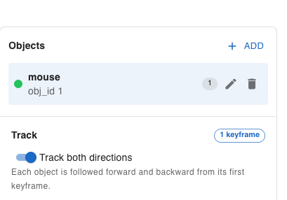

#### Step 3 — Annotate Keyframes

You annotate a **few keyframes**, not every frame. The tracker follows each object through the rest of the video.

##### Browsing Frames

Use the frame browser under the canvas:

- **Chunk selector** — switch between chunks of a long video. Opening a new chunk extracts its frames on the service first, so the slider pauses briefly.
- **Frame slider** — the frame loads when you release the slider.
- **Previous / Next frame** buttons — step one frame at a time.
- **Keyframe markers** — frames you have already annotated are marked on the slider.

Frames are numbered by **decoded frame index**, straight from the service. The elapsed time shown is approximate on variable-frame-rate recordings; the frame number is the exact reference.

<!-- TODO: screenshot of the frame browser with keyframe markers -->
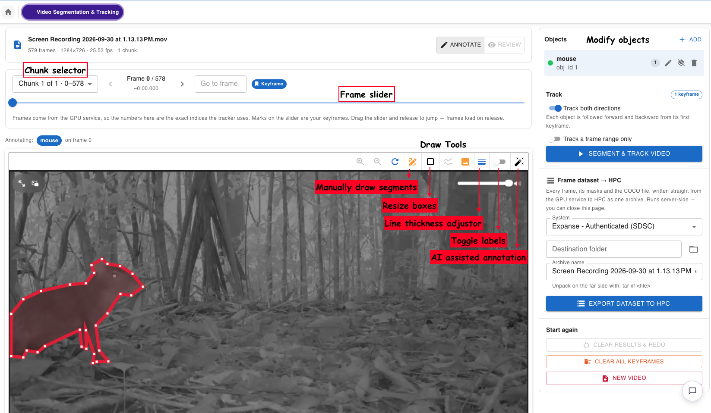

##### Drawing Masks

Scrub to a frame where the object is clearly visible, then draw it with either tool:

- **Polygon tool** — click points around the object. Press **Enter** or click the first point to close the polygon.
- **SAM3 click** — click on the object and SAM3 generates its mask.

If an object is selected in the **Objects** panel, the new mask goes straight to that object. Otherwise the **Assign this region** dialog opens: pick an existing object, create a new one by typing a label (e.g. `torch`, `weld_pool`), or click **Discard region**.

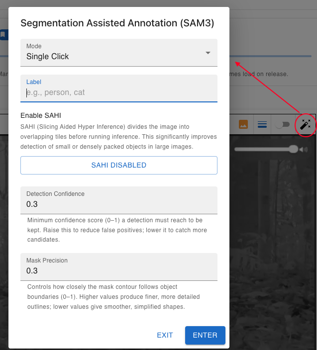

> **Tip:** Annotate a few keyframes spread across the video, especially where an object changes shape, is partly hidden, or reappears. An object can first appear on any keyframe; it is tracked backward from there too, so you do not need to find its first frame.

Keyboard shortcuts: **Enter** closes a polygon, **Esc** cancels the current tool, **Delete** removes the selected mask.

#### Step 4 — Track

In the **Track** panel:

- **Track both directions** (default) follows each object forward and backward from its keyframes. Switch it off to **Track forward only**.
- **Track a frame range only** limits tracking to a **Start** and **End** frame. The arrow buttons set either one to the frame currently on screen.

Click **Segment & track video**. Tracking runs on the GPU, one job at a time. Progress is shown by chunk and frame, and you can cancel the job at any time.

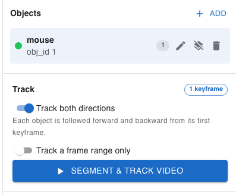

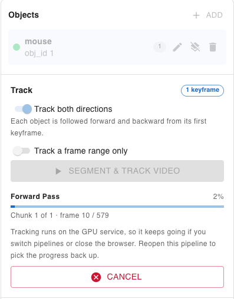

> **Note:** The first job after the service starts can sit at 0 frames for a minute or two while SAM3 loads. If a running job reports no progress for a long time, the panel shows a **No progress for a while** warning.

#### Step 5 — Review & Export

##### Reviewing Results

Scrub through the video to check the tracked masks. Toggle between:

- **Overlay** — masks drawn on top of the frame.
- **Side by side** — the masked frame next to the untouched frame for comparison.

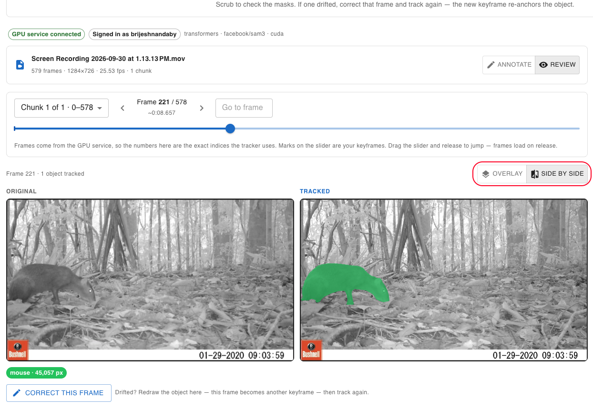


If a mask drifted, go to that frame, correct it on the annotation canvas, and click **Track again**. The corrected frame becomes a new keyframe that re-anchors the object. Re-tracking starts a new job that replaces the previous results.

##### Exporting

The **Export** panel offers two files for a finished job. Each can be downloaded to your computer or sent **To HPC**:

- **Annotated MP4** — the video with masks drawn on it. The service renders it on first request, so expect a wait on long videos.
- **COCO JSON** — per-frame masks for every object, ready for training frameworks.

Choosing **To HPC** opens a dialog to pick a **System**, a **Destination folder** (blank for your home directory), and a **Filename**.

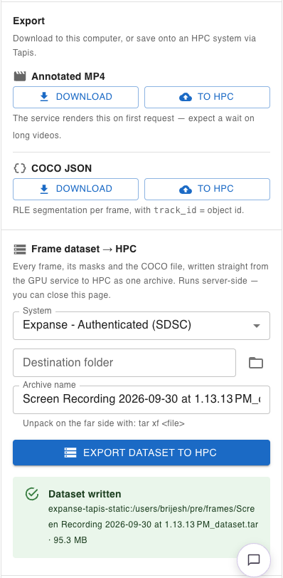

##### Exporting a Dataset to HPC

To build a training dataset, use **Export dataset to HPC**. Pick a **System**, a **Destination folder**, and an **Archive name** (default `<video>_dataset.tar`). The gateway extracts every frame and, if a tracking job has finished, adds its masks and COCO JSON, then writes the `.tar` straight to HPC. Unpack it with `tar xf <file>`.

Progress moves through **Extracting frames from the video → Collecting masks and building the archive → Uploading to HPC**. The export runs on the server, so you can close the tab or switch pipelines; progress is picked back up when you return.

---

# How-To Guides

### How to Create a Video Pipeline

1. From the **Dashboard**, click **+ New Pipeline**.
2. Enter a **Pipeline Name** and a valid **SLURM Account**.
3. Under **What will you annotate?**, choose **Video — segment and track through a video**.
4. Optionally add a **Description**.
5. Click **Create & Open**.

### How to Upload a Video Already on HPC

1. In Step 1, choose **HPC storage**.
2. Select the **System** the video is on.
3. Enter the full **Video file path**, or click the browse icon to pick it.
4. Start the upload. The video is downloaded from Tapis, then sent to the GPU service.

### How to Fix a Mask That Drifted

1. In the results view, scrub to the first frame where the mask is wrong.
2. Select the object in the **Objects** panel and redraw its mask on that frame.
3. Click **Track again**.

### How to Start Over

The **Start again** section offers three actions, each behind a confirmation:

- **Clear results & redo** — discard the tracking results and keep your keyframes.
- **Clear all keyframes** — remove every keyframe mask and rebuild from scratch.
- **New video** — leave this video and upload a different one.

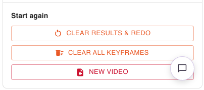

### How to Resume a Video Pipeline

From the **Dashboard**, open the **Videos** tab and click **Open Pipeline** on the pipeline card. Your objects and keyframe masks are restored.

> **Note:** Resume state is stored in your browser. Opening the pipeline on another device or browser starts it fresh.

### How to Connect to the SAM3 Video Service

Set these in `client/.env` (see `client/.env.example`):

| Variable | Purpose |
| --- | --- |
| `SAM3_VIDEO_URL` | Address of the auth gateway, or of the service itself (e.g. `http://127.0.0.1:2129` through an SSH tunnel). |
| `SAM3_VIDEO_AUTH` | `gateway` when `SAM3_VIDEO_URL` points at the auth gateway; `none` (or unset) for a direct connection. |
| `SAM3_ENDPOINT` | Per-image SAM3 service used for SAM3 clicks on keyframes. |
| `TAPIS_BASE_URL` | Tapis tenant, used for HPC uploads and exports. |
| `ANNOTATOR_TYPE` | `VIDEO_SEGMENTATION` for a video-only instance, `SEGMENTATION` for images and video together, or empty for all types. |

**Direct connection over SSH.** If the service runs on an HPC GPU node, open a tunnel and keep it open while you work:

```bash
ssh -L 2129:localhost:2129 user@gpu-host
```

Leave `SAM3_VIDEO_AUTH` unset for a direct connection. Setting it to `gateway` against the bare service makes every request fail CORS.

**Through the auth gateway.** Point `SAM3_VIDEO_URL` at the gateway and set `SAM3_VIDEO_AUTH=gateway`. The page's origin must be in the gateway's allowed origins. Dataset export to HPC is available only in this mode.

---

# Explanation

### Architecture

```
Browser (Smart Labeler client)
  │  @icicle-ai/video-segmentation
  │
  ├── SAM3 Video Service (GPU node) ──── upload, frame extraction, tracking jobs,
  │      (optionally behind the            MP4 / COCO rendering
  │       auth gateway)
  │
  ├── Auth gateway ──────────────────── Tapis sign-in, dataset export to HPC
  │
  └── Tapis Files API ───────────────── HPC video download, MP4 / COCO save
```

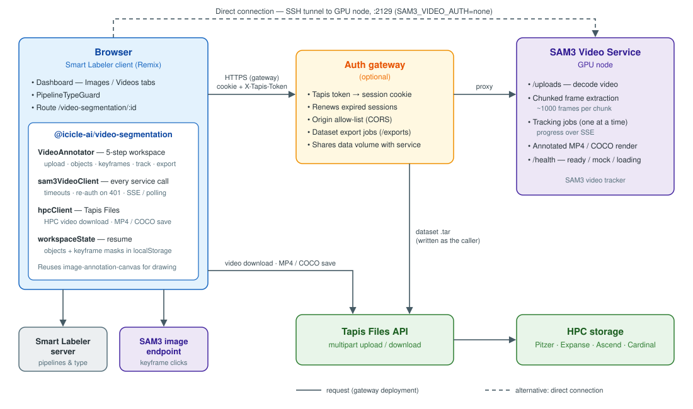

The workspace is the `@icicle-ai/video-segmentation` package. The client route supplies only the pipeline ID and the Tapis token. All calls to the SAM3 Video Service go through one typed client, `sam3VideoClient.ts`.

### Keyframes and Tracking

You annotate a few keyframes; the SAM3 video tracker propagates each object's mask through the rest of the video. Each object has a stable ID shared across keyframes, which tells the tracker the masks belong to the same object. With **Track both directions**, an object is followed backward from its earliest keyframe as well as forward.

Tracking runs as a job on the service. Progress streams to the browser over Server-Sent Events and falls back to polling when a proxy buffers or strips the stream. A new job replaces the previous results.

### Frame Indexing and Chunks

Frames are addressed by the service's **decoded frame index**, never by timestamp × frame rate. That is why the workspace fetches frames as images rather than playing the video in a video element: on a variable-frame-rate recording, a timestamp would drift away from the frame the tracker means.

Long videos are split into chunks of about a thousand frames. Opening a chunk extracts its frames on the service. The frame browser fetches only the frame you settle on, cancels requests you have scrolled past, and pre-fetches neighbouring frames once the current one has loaded — frames often travel over an SSH tunnel.

### Authentication

On a direct connection, requests carry no credentials. The bare service allows any origin, and browsers refuse credentialed requests to a wildcard origin.

Behind the auth gateway, the Tapis token is exchanged for a session cookie, which also authenticates the progress stream (`EventSource` cannot send custom headers). The token is additionally sent as an `X-Tapis-Token` header on every request, so the workspace still works when embedded in another site that blocks third-party cookies. An expired session is renewed automatically.

### Output Formats

- **Annotated MP4** — the source video with coloured masks drawn on it, for review and sharing.
- **COCO JSON** — per-frame instance masks for every tracked object, compatible with tools such as CVAT and Roboflow and frameworks such as MMDetection and Detectron2.
- **Dataset archive (`.tar`)** — the extracted frames plus, when a tracking job has finished, its masks and COCO JSON. Built and written to HPC by the gateway so hundreds of megabytes never pass through the browser.

### Limitations

- Resume state lives in the browser's `localStorage`, so it does not follow you to another device.
- The service runs one tracking job at a time.
- The annotated MP4 is rendered on first request and can take several minutes for long videos.
- Dataset export to HPC requires the auth gateway.
